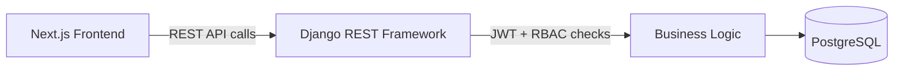

# Multi-Tenant Timesheet Platform

A multi-tenant SaaS platform for managing employee timesheets, approvals, and payroll processing, built with a team of five developers.

> 🔒 **Source code is private** (built for an organization). This repository documents the project and my contributions.

## Tech Stack
Python · Django · Django REST Framework · PostgreSQL · JWT · Next.js · Git/GitHub

## What It Does
- Employees submit timesheets, managers approve them, and finance processes payroll, all in one system
- Supports multiple organizations (tenants) on one platform, each with its own isolated data
- Role-based workflows for 5+ user roles

## Architecture

## My Contributions
- Built **10+ REST APIs** for timesheet submission, approval, and payroll processing
- Implemented **JWT authentication** and **Role-Based Access Control (RBAC)**, enforcing multi-tenant data isolation at both the API and database levels
- Designed the end-to-end approval workflow: **Employee → Manager → Finance**
- Integrated the Django REST APIs with the **Next.js** frontend
- Wrote functional and security test cases for core modules, reaching **85% test coverage**

## Impact
- Cut manual processing time by **30%** for **50+ users**
- Reduced unauthorized access risk by ensuring each tenant and role only sees its own data

